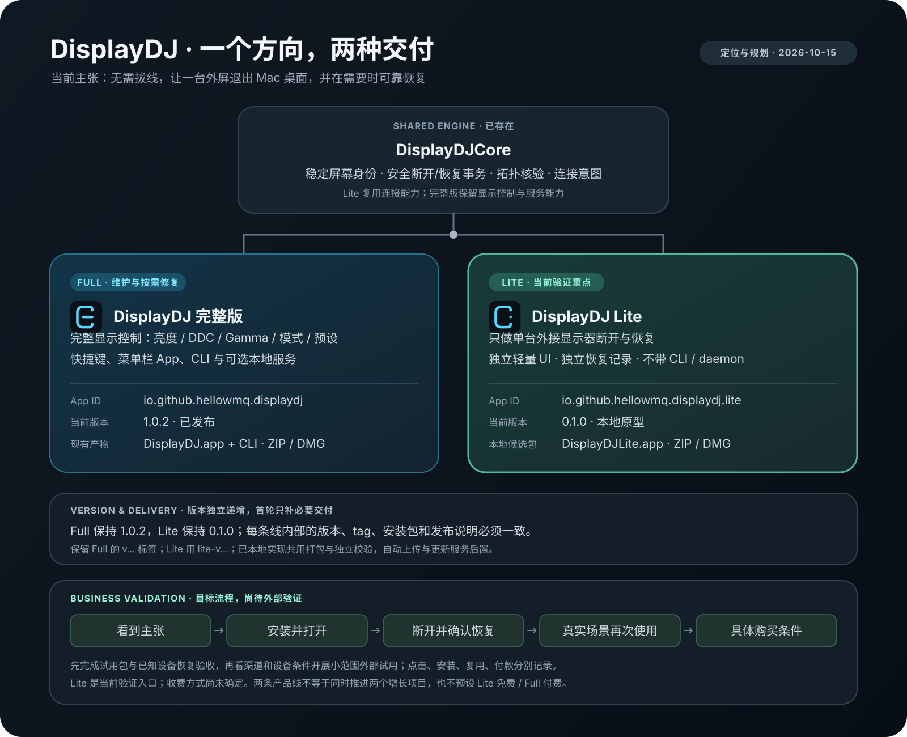

# DisplayDJ 双产品线、版本与首轮商业验证

定位规划：2026-10-15；维护实施更新：2026-10-16。产品定位与版本规则已明确。产品化打包、Lite 图标/面板和维护契约已本地实现，发布与外部试用仍待执行；最新执行记录见 [维护标准](MAINTENANCE.md) 和 [Lite 验证记录](DISPLAYDJ-LITE.md)。尚未公开发布、上线统计、联系用户或收费。



## 一个产品方向，两个交付形态

DisplayDJ 的当前商业主张是：**无需拔线，让一台外接显示器退出 Mac 桌面，并在需要时可靠恢复。**

- **Lite 是本阶段重点验证入口。** 面向只需要断开和恢复外屏的人，优先验证是否容易理解、容易安装、少出错、能独立恢复。
- **完整版进入维护和按需修复节奏。** 保留亮度、DDC、显式 Gamma、模式、预设、快捷键、CLI 和可选服务，服务已有复杂控制场景；有明确需求证据后再扩展。
- 两者共用品牌和连接内核，不同时启动两套获客实验。不预设 Lite 免费、Full 付费，也不把功能数量作为付费理由。

Lite 操作会改变 macOS 桌面拓扑，窗口可能移到其他在线屏幕。它不等于显示器电源开关、输入源切换，也不能在断开物理屏幕后保留该屏桌面预览。需要后两种工作流的反馈应另行记录，不能算作 Lite 已满足需求。

该方向符合用户提供的《个人开发者商业化与社区影响力战略评估》（2026-10-13）所强调的聚焦实际问题、优先分发和验证外部使用。战略材料里的市场、流量、报价和人数建议仍是参考输入；本稿没有重新验证其外部数据，也不将其转为自动执行或收费授权。

## 当前产品与证据

| 项目 | 完整版 | Lite |
| --- | --- | --- |
| 当前版本 | 1.0.2，已有公开发布 | 0.1.0，本地原型，已有本机安装 |
| Swift target / 入口 | `DisplayDJBar`，以及 `display-cli`、`displaydj` | `DisplayDJLite` |
| Bundle 文件名 | `DisplayDJ.app` | `DisplayDJLite.app`；展示名为 DisplayDJ Lite |
| Bundle ID | `io.github.hellowmq.displaydj` | `io.github.hellowmq.displaydj.lite` |
| 功能边界 | 完整显示控制和自动化 | 单目标外屏断开、恢复、错误重试、退出恢复选择 |
| 核心依赖 | `DisplayDJCore`，另有 `VibeDisplayCore` / `VibeDisplayServer` | `DisplayDJCore` |
| 恢复记录 | Full 自己的数据目录 | Lite 自己的数据目录；不接管 Full 恢复记录 |
| 已有打包能力 | ZIP / DMG、SHA-256、包一致性检查 | App 构建、bundle smoke、产品独立的 ZIP/DMG 与完整包校验 |

具体 Lite 实现与历次验证见 [DISPLAYDJ-LITE.md](DISPLAYDJ-LITE.md)。已记录的本地测试、构建和 UI 检查属于工程证据；不能代替外部安装、重复使用或付款证据。此前 HP D27k 恢复确认有设备记录，但修复后经 Lite 按钮完成新一轮真实断开/恢复，以及真实“恢复并退出”仍是本稿的设备验收留项。

## 版本规则：各自递增，内部一致

**不用让 Full 和 Lite 的版本数字相等，也不要求同时发版。**

| 规则 | 约定 |
| --- | --- |
| 版本来源 | Full 沿用 `Sources/VibeDisplayCore/Support/Version.swift`；Lite 沿用 `LiteIdentity.version`。每条线只维护一个权威来源 |
| 当前版本 | Full 保持 1.0.2，Lite 保持 0.1.0；本次补图和规划不触发 App 版本递增 |
| 产品内一致性 | tag、版本源、App plist、发布标题、包文件名及说明须匹配同一产品版本；Full 还要核对两个 CLI 版本 |
| 修复与功能 | 产品修复发 patch；新增兼容功能按该产品阶段递增 minor。Lite 0.x 的规则和可能变化在说明中写清，不把 0.x 视为可忽略恢复可靠性的理由 |
| 共享内核变化 | 评估并验证两条线；需要交付变化的产品分别升版。未包含变化的已发布包不会因代码共用而自动获得修复 |
| 同批发布 | 可以从同一 commit 构建不同版本的两款 App；版本号无需相同 |
| 历史与后续 tag | Full 保留既有 `v<version>` 习惯，例如 `v1.0.3`；Lite 使用 `lite-v<version>`，例如 `lite-v0.1.0`。这些是命名示例，不代表已安排发版，不改名旧 tag |
| 定位与价格 | 版本号不表示付费级别。Lite 1.0、收费形态与更广兼容承诺都需要各自的验收依据 |

这修正了初稿同时改 Full/Lite tag 前缀的建议：优先保留 Full 的历史路径，只给新增 Lite 定义可区分的前缀。共享内核用构建 commit 标识来源，本轮不再建立第三条内核发版线。

## 发布器：先完成首轮试用必需部分

现有 `package.sh`、`package-dmg.sh` 已收敛为同一 `package-product.py` 实现，`--product full|lite` 选择产品，`verify-package.py` 同时校验两产品的 ZIP/DMG。本地流程只构建、打包和验证，没有自动上传 GitHub。默认 ZIP，`--format all` 从一次构建同时生成两种格式。

下列命令已实现；应使用新的独立输出目录，避免覆盖已有产物：

```text
bash scripts/package.sh --product lite
bash scripts/package-dmg.sh --product lite
python3 scripts/verify-package.py <archive> --product lite --expect-version 0.1.0
```

Full 原有无参数入口继续兼容。产品选择明确控制下表，不以文件名猜测产品，也不为发布重命名已安装的 Lite bundle。

| 发布契约 | Full | Lite |
| --- | --- | --- |
| App | `DisplayDJ.app` | `DisplayDJLite.app` |
| 产物前缀 | `displaydj-<version>-macos-<arch>` | `displaydj-lite-<version>-macos-<arch>` |
| 必须包含的可执行文件 | `DisplayDJBar`、`display-cli`、`displaydj` | 只有 `DisplayDJLite` |
| 图标 | 现有 Full 图标 | 已通过的 Lite v2 已接入资源和 plist，菜单栏使用同家族模板图标 |
| 说明 | Full 的功能、安装与升级说明 | 单一工作流、窗口迁移行为、恢复方法、签名状态和实测环境 |
| 下载入口 | 指向明确的 Full 版本与资产 | 指向明确的 Lite 版本与资产；同时提供 Full 的次要入口 |

首轮最小交付：

1. **构建一次，归档两种格式。** 同一产品的 ZIP 与 DMG 复用同一个已验证 App；记录 commit、版本、架构和签名状态，避免分别重构建后混用验收结果。
2. **校验按产品隔离。** 核对 bundle ID、版本、图标资源、架构、签名、许可文件、确切可执行文件集合、ZIP 逐文件一致性、DMG 挂载内容和 SHA-256；Lite 混入 Full CLI 必须失败。同名既有产物继续拒绝覆盖。
3. **安装说明真实。** 当前本地构建为 arm64、ad-hoc、未公证；在下载前说明支持范围和首次打开步骤。Developer ID / 公证作为安装信任改进项评估，未完成时不写成已解决，也不擅自购买账号。
4. **入口可区分。** README 和现有网站用一个 Lite 主张与主下载入口承接试用；Full 作为进阶入口。两条线共处一个仓库时，下载按钮必须按产品核对，不能依赖含义不明的通用 latest 链接。
5. **公开交付可回读。** 获得发布授权后从确定 tag 构建，分别写说明；上传后检查实际 Release 及下载字节/哈希。当前包和网站尚未按此方案发布。

普通 CI 继续验证共享源码和两款 App 的构建/包身份。自动创建 tag、自动上传、独立更新服务、支付与授权系统均后置；重复的真实发布工作出现后再决定是否增加统一 `release.sh`。

## 首轮商业验证：一条工作流，一组证据

### 用户与假设

先找实际使用 Mac 与外屏、曾为暂时停用外屏而拔线或处理不可见窗口的人。共享游戏机/另一台电脑只是候选场景，访谈要确认他需要的是收回窗口、切输入源还是保留副桌面预览。设备试用初期优先有内建屏可恢复操作的 MacBook 用户，并按真实支持范围筛选。

需要验证的假设是：这些用户愿意选择一个操作更少、恢复清楚的工具，并会在下一次真实场景中再次使用。当前不能从代码完成、内部验收或下载计数得出该结论。

### 顺序与验收

以下按开始后的相对阶段推进，不承诺固定招募人数。负责人为用户与获授权的 Codex：Codex 准备包、说明和记录，用户选择渠道与试用对象；对外发布和联络需要对应授权。

| 阶段 | 交付物 | 验收及当前状态 |
| --- | --- | --- |
| A：固定候选 | Lite 版本、commit、试用包、安装说明、已知限制与恢复步骤 | **本地候选已构建校验；固定发布 commit/tag 与首装待执行。** 不把本地脏工作区包视为已公开试用包 |
| B：完成设备门槛 | 已有明确外屏的一轮 Lite 断开→恢复及恢复并退出记录 | **待执行。** 对象身份一致，用户观察和新拓扑核验支持成功；失败先闭环，不扩大试用，不操作无关设备 |
| C：确认渠道和需求 | 一个主渠道、一个备用渠道及具体需求记录 | **待执行。** 先核对社区规则和受众，争取 3–5 次探索性访谈；该数值是努力方向，未达不算需求被否定，也不要求访谈者先安装 |
| D：小范围外部试用 | 可用设备上的安装、完整恢复和协助记录 | **条件满足后执行。** 视渠道和设备争取 1–2 个外部案例；分别记录失败、完成与需要帮助的程度，不宣传广泛兼容 |
| E：回访与决策 | 再次使用的实际场景、替代方案、购买条件与继续/修复/调整结论 | **待执行。** 72 小时只作为首个回访点；不满观察期或场景尚未再次发生时保留未知，意向不记作付款 |

这些阶段只验证现有 Lite 工作流，不在实验中附带开发实时预览、输入切换、Pro 功能或新后端。既有策略工作区的两周计划包含共享屏探索；本稿只细化 Lite 的当前交付，不将那些候选能力视为已实现。

### 分发与使用的记录口径

| 环节 | 收集方式 | 可以说明什么 |
| --- | --- | --- |
| 看到主张 | 实际页面/渠道和可取得的访问数；曝光不可读则标未知 | 是否触达目标受众，不用全站流量代替产品入口流量 |
| 点击下载 | 复用现有网站统计，核对产品、版本、CTA 和渠道 | 说明点击；GitHub DMG/ZIP 请求增量另记，不能两者相加冒充独立下载者 |
| 安装与首次启动 | 试用者自愿反馈结果、耗时和阻塞步骤 | 说明安装，无法用匿名下载计数反推 |
| 完成核心任务 | 同一目标的断开、恢复、产品核验与使用者观察 | 说明在这一环境中完成，不把按钮点击当作成功 |
| 再次使用 | 回访时记录是否因实际需求再次操作及观察窗口 | 说明重复使用；受催促复测另列 |
| 商业信号 | 开放询问值得付费的部分、可接受交付和购买条件 | 说明意愿；实际支付需单独记录，当前没有据此收款 |

不新增 App 遥测。网站若需补事件，先检查既有采集，避免一次点击重复计数；只传产品、版本、入口位置、渠道等必要字段。联系方式、屏幕 UUID、序列号和原始日志不进入网站统计。匿名访问与自愿反馈分别汇总，不声称已将整条漏斗逐人关联。

试用记录模板（目前为空，不预填成功案例）：

| 匿名编号 | 渠道 | 版本及环境概况 | 安装结果/耗时 | 断开结果 | 恢复结果 | 协助分钟 | 回访日期及观察期 | 实际再次使用 | 购买条件 | 问题编号 |
| --- | --- | --- | --- | --- | --- | --- | --- | --- | --- | --- |
| 待记录 | — | — | — | — | — | — | — | — | — | — |

### 继续与停止条件

- **恢复没有确认成功：** 先处理该案例并提供恢复支持，暂停该环境后续操作和扩大试用；不靠新增功能绕过问题。
- **安装需要反复协助：** 优先修复包、说明、签名信任或首装流程，记录每例协助成本。
- **没有有效回复：** 先检查触达与受众匹配，不把渠道失败写成没有需求。
- **任务完成但不再使用：** 区分场景频率低、观察期不足、已有替代方案足够和价值不足，再决定是否收窄或调整。
- **有重复痛点、能独立完成并真实复用：** 用本轮触达与设备数据设下一轮试用规模，再验证具体报价/交付形式。
- **只有口头付费意向：** 仍不能称为收入验证，也不据此开发付费墙或把 Full 自动改成 Pro。

## 下一实施里程碑

本稿与图已补全定位、版本规则、最小打包范围和商业验收；接下来是**让 Lite 有一个能独立安装、能确认恢复、支持范围清楚的试用包**。先完成阶段 A/B，再用现有网站和一个合适渠道验证，不同时启动两款产品的增长计划。

App 版本仍分别为 Full 1.0.2、Lite 0.1.0；打包和 Lite UI 改动已在本地实施，候选包/界面验证记录分别留存。网站、统计、外部试用、公开发布尚未执行；源码提交和 CI 以远端实际记录为准。Full 全面交互改版仍按已选稿后续实现，不与 Lite 本轮完成状态混写。
