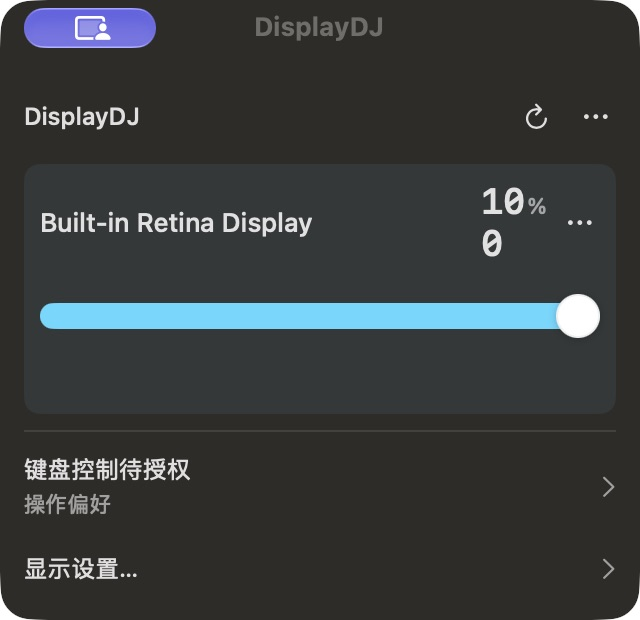

# DisplayDJ 1.0.2

## 2026-10-25 原位更新 / Refreshed build

按维护者明确授权，保留 `v1.0.2` 与原下载文件名，更新标签源码、ZIP、DMG 及各自 SHA-256。Full 继续作为最新稳定版。已下载旧包的用户需重新下载，并使用本次新校验文件；相同版本号不表示文件相同。

- 交付已选 Full 主面板：逐屏亮度卡片、等宽读数、明确的菜单栏滚轮与键盘目标、逐屏请求/确认/失败反馈、分组设置。
- 断开前显示独立确认，提交前核对稳定目标；GUI 退出前恢复并核验当前记录，失败保留记录并取消退出。
- 使用原生刷新图标的稳定轴心，按下即时响应、单次短旋转；稍久读取显示静态“刷新中”，快速读取不闪现文字。保持单色，亮度操作不触发刷新动画。
- 系统减少动态效果或 macOS 13/14 使用静态刷新反馈。
- 756 项自动测试通过；Full/Lite 原生刷新、生命周期及减少动态效果检查通过。内建屏与历史外屏证据分列，未扩展 Intel、最低系统、干净首装、睡眠唤醒或全型号支持承诺。

发布包仍为 Apple Silicon arm64、ad-hoc 签名、未经 Apple 公证。升级与全局快捷键重新授权步骤见下文。完整验证见 [本次更新记录](RELEASE-REFRESH-2026-10-25.md)。

**English:** This in-place refresh delivers the selected Full interaction design, stable per-display values and feedback, safer connection confirmation and restore-before-quit, and faster native refresh-symbol feedback. Download again if you have an earlier 1.0.2 build, and use the new SHA-256 file. The existing tag and asset names are retained at the maintainer’s explicit request. Distribution remains arm64, ad-hoc signed and not notarized.

## 2026-10-12 首次发行（历史记录）

键盘调光现在提供逐屏亮度指示器，连续调节保持数值稳定；新增可单独启用的亮度媒体键，并修复固定快捷键事件透传问题。

## 主要变化

- **亮度媒体键**：默认关闭，启用后接管无修饰键的亮度动作。目标可选择当前选中屏或鼠标所在屏；一次媒体键长按固定目标，普通功能键、音量和播放键保持原行为。
- **连续调节**：按键每次增减 5 个百分点，读取或慢写期间的连续输入串行合并、逐步限幅，保留真实硬件基线和回读验证；多屏同步与手动控制优先级继续适用。
- **逐屏提示**：固定快捷键 `⌃⌘- / ⌃⌘=` 和媒体键均显示目标屏亮度。首次无数值时提示读取，连续读取保留可见百分比与进度条，回读成功后显示实际结果；失败明确提示，浮层不抢焦点、不拦截鼠标。
- **快捷键提示音修复**：已接管的按下、重复和抬起事件不再透传给前台应用，避免其产生无效按键提示音；其他快捷键照常使用。
- **亮度传输边界**：DDC 失败不会自动改用 Gamma；软件调光仍由用户显式启用。

## 下载与升级

提供 Apple Silicon **arm64 ZIP、DMG 及各自的 SHA-256 校验文件**，下载见 [1.0.2 Release](https://github.com/hellowmq/displaydj/releases/tag/v1.0.2)。最低部署目标为 macOS 13。App 使用 **ad-hoc 签名，未经 Developer ID 签名或 Apple 公证**。macOS 可能阻止首次启动，可在 Finder 中按住 Control 点击 App 并选择“打开”，或在“系统设置 → 隐私与安全性”允许打开。

升级前，结束正在运行的 Agent 任务并停止旧服务，退出 App 后将新版覆盖到 `/Applications/DisplayDJ.app`。复制到 PATH 的 `display-cli` 和 `displaydj` 也需更新；App、CLI 和可选后台服务应使用同一版本并共享状态目录。配置和亮度预设沿用原目录。

全局键盘控制需要辅助功能权限。**替换 ad-hoc 签名 App 后，旧授权可能因签名变化而失效，即使设置里开关仍显示已开启。** 若其他应用在前台时快捷键无效，请在“系统设置 → 隐私与安全性 → 辅助功能”移除旧 DisplayDJ 条目，再添加准确的 `/Applications/DisplayDJ.app` 并启用；若系统要求输入监控，也授予相应权限。完成后退出并重新打开 DisplayDJ。不要同时保留多个已注册的同标识 App 副本。

本机的旧签名授权失效已通过系统日志确认，重新登记后用户确认全局快捷键恢复；这不代表其他设备无需重新授权。

## 验证与边界

- **684 项自动测试**通过，覆盖键盘事件、长按与抬起、连续输入、边界反向、多屏同步失败、插拔和手动控制权。
- **13 项真实 HUD 组件运行检查**通过，包含数值保留、文案稳定、视图复用、自动关闭、关闭后清除、定位、鼠标穿透和焦点保持。
- CLI／隔离 HTTP 冒烟检查通过，无硬件写入；Release 构建和严格签名检查通过。
- 用户已确认重新授权后全局快捷键可用。独立媒体键、本轮外屏 DDC 长按、真实睡眠唤醒、Intel、最低系统和干净用户升级仍未完成实机验证。本机 Touch Bar 不等于独立媒体键测试环境。
- 长按音效修复已有事件消费回归测试，尚无独立实机听感证据；组件检查不代替完整键盘端到端验收。

首次发行源码为 `9d33002`；以下 CI 链接属于 2026-10-12 历史发行。当前 `v1.0.2` 已按维护者授权改指 2026-10-25 更新源码，见页面顶部记录。行为与开发验证记录见 [键盘亮度说明](https://github.com/hellowmq/displaydj/blob/v1.0.2/docs/KEYBOARD-BRIGHTNESS.md)，手动控制规则见 [手动亮度优先](https://github.com/hellowmq/displaydj/blob/v1.0.2/docs/MANUAL-BRIGHTNESS-PRIORITY.md)。

最终 ZIP 内容一致性、DMG 挂载后的全部文件、内嵌 MIT 许可证、严格签名、包内 CLI 冒烟及 SHA-256 均通过检查。源码提交与标签 CI 通过：[master 检查](https://github.com/hellowmq/displaydj/actions/runs/38218665868)、[v1.0.2 标签检查](https://github.com/hellowmq/displaydj/actions/runs/38218772566)。
