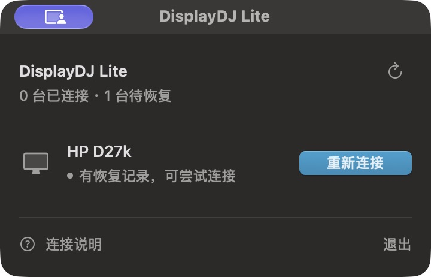

# DisplayDJ Lite 0.1.0 — 预发布 / Prerelease

2026-10-16 · [下载 ZIP / DMG](https://github.com/hellowmq/displaydj/releases/tag/lite-v0.1.0)

Lite 是独立的菜单栏应用，用于将一台外接显示器从 Mac 桌面中断开，稍后重新连接。它不关闭显示器电源、不切换输入源，也不包含 Full 的亮度控制、CLI 或本地服务。Full 1.0.2 继续作为最新稳定版维护，两款应用分别安装、分别保存恢复记录。

## 本次提供

- 紧凑的原生面板、独立 Lite 图标、明确的断开确认、稳定的显示器行，以及处理中和失败反馈。
- 正常退出前恢复当前目标并核验；失败时取消退出、保留记录，继续提供恢复入口。
- 断开前启动恢复子进程，确认退出监视器已就绪后才执行断开。主界面异常结束时，子进程核对并恢复 Lite 当前可安全恢复的目标，然后结束；不安装登录项或系统服务。
- 保留已确认旧编号失效的历史记录，不冒用编号控制另一台屏幕，也不阻塞当前外屏操作或退出。原屏幕重新接入并匹配稳定身份后，可确认恢复。
- ZIP、DMG 使用同一 App 构建，分别提供 SHA-256 校验文件；仓库同步更新真实安装实例预览图与恢复说明。



## 安装与升级

发行范围为 **Apple Silicon arm64**，部署目标 **macOS 13**。安装包使用 **ad-hoc 签名，未使用 Developer ID 签名，也未经过 Apple 公证**；可能受到系统安全策略限制。最低系统版本、干净首装与广泛硬件兼容性尚未验收。

下载 ZIP 解压，或打开 DMG，将 `DisplayDJLite.app` 放入“应用程序”。升级前先在旧 Lite 中恢复当前外屏并退出，再覆盖同名应用；不要覆盖 Full 的 `DisplayDJ.app`。恢复记录保存在 App 外，覆盖安装不会删除它。校验下载文件时使用同名 `.sha256` 文件，例如：

```bash
shasum -a 256 -c displaydj-lite-0.1.0-macos-arm64.zip.sha256
```

卸载前同样先恢复并退出。删除 App 文件不等于结束运行中的进程，也没有可靠的 Finder 卸载回调。具体步骤见 [恢复、覆盖安装与卸载](LITE-RECOVERY.md)。

## 验证与限制

- 完整自动测试 **717 项通过**，包含 29 项 Lite 测试；测试使用隔离存储与模拟事务，实体测试单列。
- 已在 **Apple M1 / macOS 27.0.1 / Dell D2720DS** 核验普通重连、恢复并退出，以及主界面 `SIGKILL` 后的恢复保护。强制结束后约 **7.3 秒**恢复上线，子进程随后结束；用户确认外屏画面正常。
- 覆盖安装后的签名、App 内容、运行路径与恢复记录保留已核对。ZIP / DMG 的内容、架构、版本、签名和校验和已核验。
- 早期仅依赖 `.forAppOnly` 的回收测试未通过，最终版本增加恢复子进程；不能将 API 作用域本身宣称为已经验证的恢复保障。
- HP 实体不在本次连接中，其历史记录保留。其他型号、连接方式、VoiceOver、完整浅色验收及同时结束两个进程的情况未覆盖。预发布不承诺所有系统或硬件异常均可恢复。

[实体设备验收](LITE-DEVICE-VERIFICATION.md) · [构建与验证记录](DISPLAYDJ-LITE.md) · [素材维护](PREVIEW-ASSETS.md)

## English

DisplayDJ Lite 0.1.0 is a separate prerelease for disconnecting and reconnecting one external display. It adds a compact native panel, explicit confirmation, verified restore-before-quit, and a recovery child process that must acknowledge readiness before disconnecting. After GUI termination, that process revalidates and restores applicable Lite targets, then exits. Historical records with reused runtime IDs remain intact without operating another display or blocking its controls.

**Apple Silicon arm64; macOS 13 deployment target; ad-hoc signed and not Apple-notarized.** ZIP and DMG contain the same App and have SHA-256 files. Restore and quit before replacing or uninstalling Lite; keep it separate from Full's `DisplayDJ.app`.

717 automated tests passed. Ordinary reconnect, restore-and-quit, and GUI-SIGKILL recovery (~7.3 seconds) passed on Apple M1 / macOS 27.0.1 / Dell D2720DS, followed by user confirmation of a normal picture. This does not establish broad compatibility or recovery when both processes are terminated. Full 1.0.2 remains the latest stable product.
